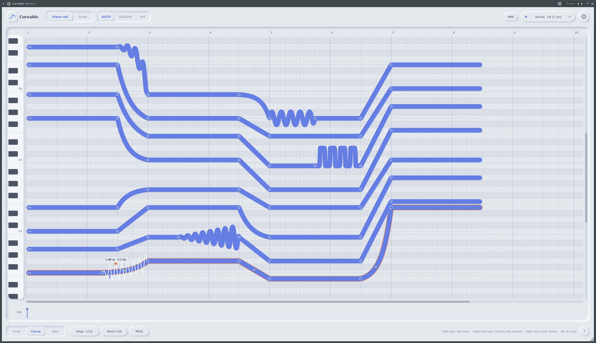
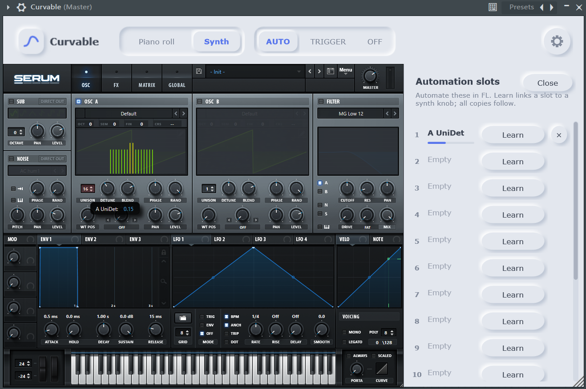

# Curvable

**English** | [简体中文](README.zh-CN.md)

Curvable is an instrument plugin with its own piano roll, in which every note has its own pitch curve. Draw slides, scoops, falls, vibrato and trills note by note, and let each note of a chord bend its own way.

Curvable does not make sound by itself. It hosts the synth you already use and runs extra copies of it, one for each note that bends differently. Each note then gets its own pitch bend, even if the synth has no MPE support. Synths that do support MPE can run as a single copy instead.

Curvable is designed for FL Studio on Windows, whose piano roll cannot bend the notes of a chord independently.



## Features

- **Per-note pitch curves.** Add points, drag them to any pitch, and shape each segment from straight to strongly curved. Points snap to semitones and the grid; hold Alt for free movement.
- **Vibrato and trill.** Apply them to the whole note or to chosen segments, each with its own settings. Set depth, speed and fade-in with handles on the note. Speed can be in Hz or locked to the tempo.
- **Ready-made bends.** Scoop, overshoot, bend and release, fall and doit, from the right-click menu.
- **Curve presets.** Save a curve and apply it to any number of notes in any project. It stretches to each note's length.
- **Glide.** Merge a line of notes into one legato note that slides between the pitches. Glide between chords, voice by voice.
- **Slice tool.** Cut notes without changing how they sound.
- **Independent bends for any synth.** Up to 16 notes can bend independently at the same time. Idle copies of the synth pause to save CPU.
- **MPE mode** for synths with MPE support: one copy of the synth, one MIDI channel per bending note.
- **MIDI import and export.** Drop a MIDI file into the piano roll; its pitch bends become curves. Drag the notes out to FL Studio or any DAW, with their bends, as one channel per voice or as MPE.
- **Automation slots.** Link up to 16 knobs of the hosted synth to parameters that FL Studio can automate. All copies of the synth follow.
- **Interface in English, Chinese (Simplified), Japanese, Korean and Spanish**, with light and dark themes.

## Requirements

- Windows 10 or 11 (64-bit)
- A host that loads VST3 instruments. Curvable is developed and tested with FL Studio.
- A VST3 instrument for Curvable to host

macOS builds (VST3 and AU, macOS 11 or later) are provided. They pass automated validation but have not yet been tested on real hardware.

## Installation

Download the latest release from the [Releases page](https://github.com/asahanadadesu/curvable/releases).

**Windows:** run `Curvable-<version>-Windows-Setup.exe`. It installs the plugin into the standard VST3 folder (`C:\Program Files\Common Files\VST3`). The installer is not code-signed yet, so Windows SmartScreen may show a warning; choose **More info**, then **Run anyway**. To install by hand instead, unzip `Curvable-<version>-Windows-VST3.zip` and copy `Curvable.vst3` into the VST3 folder.

**macOS:** unzip the VST3 or AU build into `~/Library/Audio/Plug-Ins/VST3` or `~/Library/Audio/Plug-Ins/Components`. The builds are not notarized, so macOS blocks them until you remove the quarantine flag, for example:

```bash
xattr -dr com.apple.quarantine ~/Library/Audio/Plug-Ins/VST3/Curvable.vst3
```

Then rescan plugins in your host. In FL Studio, open **Options > Manage plugins** and click **Find installed plugins**.

## Quick start

1. In FL Studio, add **Curvable** to the Channel rack as an instrument.
2. Click **Load synth** at the top right and choose a synth. Synths that FL Studio already knows appear in the list; you can also drag a `.vst3` file or a plugin from FL Studio's browser onto Curvable.
3. Draw notes in Curvable's piano roll with the **Draw** tool.
4. Switch to the **Curve** tool, click a note to add a bend point and drag it up or down. Right-click a note for vibrato, trill, ready-made bends and presets.
5. Set **Bend** at the bottom to the pitch bend range of your synth, and set the synth to the same value. Press play in FL Studio.

Press **F1** or click **?** in Curvable for the full list of mouse and keyboard actions.



## Documentation

- [User guide](docs/user-guide.md): every feature, settings and troubleshooting
- [Changelog](CHANGELOG.md)

## Good to know

- Because Curvable runs several copies of your synth, effects built into the synth (reverb, delay and similar) are applied once per copy. Turn them off in the synth and use your host's effects instead.
- CPU and memory use grow with the number of copies. Sample-based instruments use extra memory for every copy.
- Free-running LFOs and random oscillator phases can make the copies sound slightly different. Turn on retrigger in the synth where available.
- The pitch bend range in Curvable must match the synth's. If bends sound too wide or too narrow, check this first.

## License

Curvable is free software, licensed under the [GNU Affero General Public License v3.0](LICENSE). It is built with [JUCE](https://juce.com) and tested with [Catch2](https://github.com/catchorg/Catch2).

---

## For developers

### Building

Requirements: CMake 3.25 or later and a C++20 compiler (Visual Studio 2022 or later on Windows, Xcode on macOS).

```bash
git clone --recursive https://github.com/asahanadadesu/curvable.git
cd curvable
cmake -B build -S .
cmake --build build --config Release
ctest --test-dir build -C Release
```

The plugin is written to `build/Curvable_artefacts/Release/` (VST3 and Standalone; AU on macOS).

On Windows, `scripts/link-dev-vst3.ps1` (run once as administrator) links the system VST3 folder to the build output, so hosts always load the latest build. Remove the link with `-Remove` before installing a release, because the installer replaces `Curvable.vst3` in that folder.

### Tests

- `tests/` contains the unit tests (Catch2). They cover the curve model, editing operations, voice allocation, playback, serialization, MIDI import and export, and translations.
- `tests/smoke/` contains a hosting test that loads a real VST3 instrument: `curvable_hosting_smoke <path to .vst3>`.
- CI runs the unit tests and [pluginval](https://github.com/Tracktion/pluginval) on Windows for every push, and on macOS weekly and for releases.

### Project layout

```
src/
  model/     notes, pitch curves, editing operations, project storage
  engine/    scheduling, voice allocation, pitch bend playback
  hosting/   hosting the synth and its copies
  io/        MIDI import and export
  i18n/      interface translations
  plugin/    the plugin processor and editor
  ui/        piano roll and other interface components
tests/       unit tests and the hosting smoke test
scripts/     installer script and development helpers
libs/        JUCE and Catch2 (git submodules)
```

### Translations

Interface text is written in English in the code, marked with `tr`, `trf` or `TRK`, and translated in `src/i18n/Translations.cpp`. A unit test fails if any marked string is missing a translation, so new text must be added to the table in every language.

### Releasing

1. Update the version in `CMakeLists.txt` and add a section for it to `CHANGELOG.md`.
2. Push a tag such as `v0.1.0`. CI builds and validates Windows and macOS, then publishes a GitHub release with the Windows installer and the plugin archives. The release notes come from the changelog.
